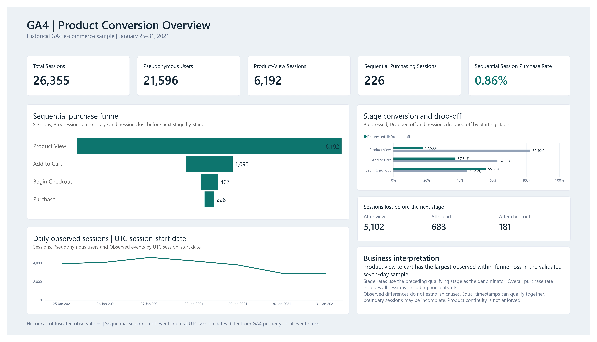

# Olist Analytics Engineering Platform

An analytics engineering portfolio that turns historical e-commerce records into reporting datasets, customer analysis and business dashboards. Python loads Olist CSVs into BigQuery; dbt models order, item and customer grains; Power BI presents the results; and Gemini generates monthly commentary checked against warehouse KPIs.

The analytical work extends to customer retention, an independent synthetic checkout experiment, a separate public GA4 conversion funnel, and a retrospective weekly revenue forecasting case study. Each module keeps its source, assumptions and validation scope explicit.

**Scope:** local execution and historical validation, with no production deployment. The evidence below distinguishes saved warehouse results, documented offline runs and test definitions. This documentation refresh does not rerun those workloads.

## Architecture



[Editable Mermaid source](docs/architecture/analytics-platform.mmd) | [Diagram conventions and export instructions](docs/architecture/README.md)

Solid arrows show data flow; the separate Airflow band shows task order. Olist CSV loading is manual. Power BI refresh, GA4 and Python forecasting are outside the DAG. FX supplies no Olist business metric, and GA4 stays in BigQuery US while Olist stays in EU.

## Implemented capabilities

| Area | Analytical work | Explore |
| --- | --- | --- |
| Olist reporting | Order, payment, delivery, geography, product and seller analysis; seven-page report including two labeled synthetic A/B pages | [Dashboards](#dashboards), [dbt models](#dbt-model-architecture) |
| Customer analytics | Monthly cohorts, periodic retention, complete-follow-up M1-M3 return and purchase-behaviour segments | [Methods and reference results](#customer-analytics) |
| Experimentation | Sample-size planning, conversion inference, allocation checks, Monte Carlo simulations and hypothetical economics | [Synthetic checkout case study](experimentation/CASE_STUDY.md) |
| GA4 product analytics | Session reconstruction, sequential funnel, custom attribution proxy and measurement-quality analysis | [Methods](#ga4-product-analytics), [dashboard](#ga4-dashboard) |
| Revenue forecasting | Five-model retrospective comparison, endpoint sensitivity and chronological interval calibration | [Case study](docs/forecasting/README.md) |
| AI insights | Structured commentary, deterministic numeric checks, retry and synchronized reports | [Generation and validation](#ai-generated-monthly-insights) |

[Business questions](#business-questions) | [Ingestion](#ingestion-and-data-sources) | [Modelling decisions](#key-metrics-and-modeling-decisions) | [Orchestration](#airflow-orchestration) | [Run locally](#how-to-run-locally) | [Testing and evidence](#testing-and-validation-evidence) | [Limitations](#known-limitations)

## Dashboards

### Olist dashboard

The [editable seven-page Power BI project](dashboard/Data%20Analytics.pbip) imports Olist facts, dimensions and customer marts. Its two A/B pages use disconnected synthetic fixtures; experiment results and hypothetical economics remain separate from Olist KPIs.

[Original four-page PDF](docs/powerbi/olist-analytics-dashboard.pdf) | [Customer page notes](docs/powerbi/customer-purchase-behaviour.md) | [A/B page definitions](docs/powerbi/ab-testing-seven-pages.md)


| Page | Business purpose |
| --- | --- |
| Executive Overview | Delivered revenue, orders, customers, average order value, repeat customers and monthly trends |
| Delivery Performance | Delivery times, late-delivery rates, delay days, delivery status and state comparisons |
| Geography Performance | State-level revenue, orders, customers, average order value and delivery performance |
| Product & Seller Performance | Merchandise value, items, products, sellers and category/seller-state analysis |
| Customer Retention & Cohorts | Cohort matrix, weighted periodic retention, cumulative three-month return and purchase-behaviour segments |
| A/B Results | Synthetic conversion, effect size, confidence interval and statistical inference |
| A/B Quality & Decision | Allocation checks, hypothetical financial scenarios, guardrail availability and a conditional decision |

Additional previews: [Delivery](docs/images/powerbi-delivery-performance.jpg) | [Geography](docs/images/powerbi-geography-performance.jpg) | [Products and sellers](docs/images/powerbi-product-seller-performance.jpg).

The screenshots and PDF cover the original four pages. Pages 5-7 have definitions and validation notes, but no committed screenshots. Static PBIR/TMDL checks do not establish every Desktop interaction or cached result.

### GA4 dashboard

The [separate three-page Power BI project](dashboard/ga4/GA4%20Product%20Analytics.pbip) imports the US-region session funnel mart. It covers the historical, obfuscated January 25-31, 2021 sample and contains no synthetic experiments.

[Full three-page PDF](docs/powerbi/GA4%20Product%20Analytics.pdf) | [Dashboard setup and metric guide](dashboard/ga4/README.md)



| Page | Business purpose |
| --- | --- |
| Product Conversion Overview | Locate observed losses between product view, cart, checkout and purchase; review daily session trends |
| [Device & Acquisition Performance](docs/images/ga4/ga4-device-acquisition.jpg) | Compare device and custom-channel conversion alongside session volumes |
| [Attribution & Data Quality](docs/images/ga4/ga4-attribution-quality.jpg) | Assess attribution coverage and overlapping quality flags before interpreting channel performance |

Device, custom-channel and UTC session-start date slicers support exploration. Static exports show visible table rows; open the editable project for further inspection. Desktop review and reconciliation are reported in the dashboard guide and were not repeated during this refresh.

## Business questions

- How do order volume, delivered revenue, and average order value change by purchase month?
- Which customers place repeat orders, and what is their recorded spend?
- How long do deliveries take relative to estimated dates?
- How do payments reconcile with merchandise and freight totals?
- Which products and sellers contribute to individual orders?
- How do repeat purchases and monthly retention differ across acquisition cohorts?
- Where do observed GA4 sessions stop progressing through the purchase funnel, and how reliable are their attribution labels?
- Which weekly revenue forecasting methods hold up across historical evaluation windows and a flagged dataset boundary?
- How should a synthetic conversion experiment be interpreted alongside allocation quality, unmeasured guardrails and hypothetical economics?

## Ingestion and data sources

- **Olist Brazilian e-commerce CSVs:** customers, orders, order items, payments, reviews, products, sellers, geolocation, and category translations. Place the original files in `data/raw/olist/`; expected filenames are defined in `ingestion/olist/load_olist_bigquery.py`. Data files are not committed. dbt currently uses customers, orders, order items, payments, products, and sellers.
- **Frankfurter REST API:** latest or historical exchange rates. Dated raw JSON files are saved under `data/raw/fx/`; warehouse rows include source and ingestion timestamps.
- **Public GA4 sample:** `bigquery-public-data.ga4_obfuscated_sample_ecommerce`, restricted to January 25–31, 2021. Historical obfuscated events are separate from the Olist source data.
- **Synthetic checkout experiment:** reproducibly generated user outcomes, with hypothetical financial assumptions. These are educational experiment results, not observed Olist transactions or a deployed product test.

The [Olist loader](ingestion/olist/load_olist_bigquery.py) applies explicit schemas and replaces nine BigQuery RAW tables with `WRITE_TRUNCATE`. Staging projects source fields and standardizes selected names; intermediate models enrich records and aggregate payments/items at order grain. The independent [FX runner](ingestion/fx_api/run_fx_pipeline.py) validates responses and appends normalized currency rows; a date-level existence check skips previously loaded dates. GA4 reads public event shards directly through dbt, with no Python ingestion step.

## dbt model architecture

| Target / layer | Models | Materialization |
| --- | ---: | --- |
| Olist `dev` — staging | 6 | Views |
| Olist `dev` — intermediate | 6 | Views |
| Olist `dev` — normal marts/reporting | 11 | Tables |
| Olist `dev` — incremental demonstration | 1 | Incremental |
| GA4 `ga4_dev` — staging / intermediate / mart | 1 / 2 / 1 | Views / views / table |

The default **`dev` target enables 24 Olist models in BigQuery EU**, including the weekly forecasting input mart. **`ga4_dev` enables four GA4 models in BigQuery US**. Each target disables the other model family. Saved target-specific manifests define **156 Olist data tests** and **67 GA4 data tests**; definitions and passing warehouse results are distinguished below.

`fct_orders_incremental` remains a demonstration; it and its four tests are excluded from normal orchestration and non-incremental validation. `ref()`/`source()` dependencies describe lineage, while schema and singular tests cover keys, relationships, calendar coverage and reconciliation. See [Olist model documentation](analytics/README.md) for model grains, [GA4 documentation](analytics/models/ga4/README.md) for its separate lineage, and the [weekly mart schema](analytics/models/marts/weekly_revenue_forecasting.yml) for forecasting input definitions. Customer activity/cohort intermediate models consume `fct_orders` and then feed the customer marts: folder layers are not a strictly one-way dependency chain. Older guides retain historical inventories, including the original 19-model Olist baseline and the pre-forecasting 23-model inventory.

## Key metrics and modeling decisions

- **Order grain:** payments and items are aggregated separately before joining orders, avoiding multiplication of payment totals across item rows.
- **Customer identity:** `customer_id` identifies an order-associated record; `customer_unique_id` groups repeat purchases. The customer dimension selects the latest order's attributes.
- **Monthly attribution:** KPIs are grouped by purchase month. Delivered metrics describe orders purchased in that month whose current status is delivered, not orders delivered during that calendar month.
- **Revenue and spend:** delivered revenue sums qualifying payments. Customer-level spend and average order value include all order statuses. Missing payments may remain null. These are payment-based measures, not profit.
- **Delivery:** facts calculate elapsed delivery days and delay relative to the estimated date.
- **Growth:** safe division and consecutive-month checks avoid misleading comparisons across gaps or zero denominators.
- **Reporting window:** January 2017 through August 2018 is chosen for stable reporting coverage. A broader monthly mart is also available.

## Customer analytics

`int_customer_cohorts` assigns each stable customer to the first observed delivered-purchase month. `int_customer_monthly_activity` records delivered activity; `customer_cohort_retention` builds a complete observable monthly grid with a fixed original cohort size. Future follow-up is absent rather than converted to zero. The reporting cutoff defaults to August 31, 2018.

`customer_repeat_behavior` distinguishes repeat purchasing within the acquisition month from later-month returns. Its cumulative M1–M3 return metric uses only customers with complete three-month follow-up; it is not periodic M3 retention or a sum of monthly rates. Segments are Single-purchase, Same-month repeat only, and Cross-month repeat.

Documented reconciliation references for January 2017–May 2018 cohorts contain **75,123 customers**: **72,527 single-purchase**, **984 same-month repeat only**, and **1,612 cross-month repeat**. **790 / 75,123 = 1.052%** returned during M1–M3. These historical observations show that one observed delivered purchase dominates this cohort window; they do not establish subscription churn, lifetime loyalty or the causes of low repeat purchasing.

See the [mart definitions and reconciliation references](analytics/models/marts/customer_repeat_behavior.yml), [retention page notes](docs/powerbi/customer-retention-page.md), and [purchase-behaviour documentation](docs/powerbi/customer-purchase-behaviour.md). Offline reference calculations and Desktop/DAX verification are documented separately. Cohort acquisition means first observed activity, and current delivered status is not a point-in-time historical status.

## A/B testing and experimentation

The [synthetic checkout case study](experimentation/CASE_STUDY.md) covers prespecified two-sided hypotheses, sample-size/MDE/power planning, two-proportion statistical tests, Newcombe/Wilson confidence intervals, sample ratio mismatch detection, and Monte Carlo power/false-positive simulations. Guardrail tooling and hypothetical contribution, implementation-cost and break-even analysis connect statistical results to a conditional business decision.

The reproducible seed-42 experiment uses **4,433 users per arm** with **527 control conversions** and **603 treatment conversions**, an uplift of **1.7144 percentage points**. Fixed balanced allocation makes its SRM pass insufficient evidence of real randomisation quality. The case study does not recommend a full rollout: assumed economics and unmeasured payment/refund/latency guardrails remain important. Synthetic statistical evidence is not evidence from a real deployed experiment. Read the [module guide](experimentation/README.md) and [rendered experiment executive summary](docs/images/checkout-ab-test-executive-summary.png) for methods, assumptions and reproduction commands.

## GA4 product analytics

The separate US-region `ga4_dev` pipeline stages nested event parameters without multiplying raw rows, reconstructs sessions using `(user_pseudo_id, ga_session_id)`, and preserves every observed session in its funnel mart. Saved historical warehouse results show **67 GA4 dbt test passes**, covering event/session fields, composite grain, complete coverage, attribution consistency and ordered funnel progression.

For January 25–31, 2021, documented warehouse counts are **273,507 events**, **21,596 pseudonymous users**, and **26,355 sessions**. Sequential `view_item → add_to_cart → begin_checkout → purchase` counts are **6,192 → 1,090 → 407 → 226**. Stage flags require preceding stages in timestamp order; independent event-presence flags do not. Equal timestamps may qualify together, and product-level continuity is not enforced.

Device and custom-channel conversion analysis uses all sessions in each segment as its denominator. First-user acquisition source/medium remain available in staging and are kept separate from event/session attribution. The earliest complete non-internal event source/medium pair supplies a **custom attribution proxy, not Google's official GA4 session attribution**. Both merchandise-store domain self-referrals are investigated explicitly: **8,041 sessions** contain internal referrals, **4,045** are internal-only, and **4,200** contain conflicting pairs. These flags overlap; they do not prove a tracking cause.

See the [GA4 feature documentation](analytics/models/ga4/README.md) and [read-only funnel analysis](analytics/analyses/ga4/session_funnel_analysis.sql). GA4 is a separate historical obfuscated sample, not Olist web activity. The [standalone dashboard](#ga4-dashboard) shows a **0.86% sequential session purchase rate**. Attributed and unknown session shares are **55.88%** and **28.77%**; internal-referral and conflicting-source shares are **30.51%** and **15.94%**. Window boundaries may truncate sessions, and pseudonymous users are not necessarily people. Observed device/channel differences are not causal findings.

## Revenue forecasting case study

The [Olist weekly revenue forecasting case study](docs/forecasting/README.md) compares Naive, MA4, MA8, Drift and SES over 86 historical purchase weeks. Naive leads full-sample MAE/WAPE (R$34,070.94 / 13.72%); no model is universally superior. The final week's 49.02% decline reconciles to the original local CSVs, but source completeness remains unconfirmed.

Historical nominal 80%/90% intervals achieved 78.57%/85.71% coverage over 14 targets, with wide ranges. Finalized delivered statuses were not fully observable at the original forecast origins, so these are retrospective experiments, not operationally validated forecasts or guaranteed future coverage.

[Selected uncertainty visual](docs/forecasting/prediction-intervals.png) | [Model scores](docs/forecasting/model-comparison.csv) | [Methods, limitations and offline/Docker reproduction](forecasting/README.md)

## AI-generated monthly insights

The [generation workflow](ai/generate_insights.py) reads BigQuery/dbt monthly reporting KPIs from `monthly_revenue_reporting`. Python retrieves and formats the trusted metrics; Gemini produces structured stakeholder commentary without calculating new metrics.

From the repository root, generate the latest available reporting month or request a specific month:

```bash
python -m ai.generate_insights
python -m ai.generate_insights --month YYYY-MM
```

Pydantic enforces the response contract. A [deterministic numeric validator](ai/validate_insights.py) rejects numeric values outside the supported KPI values, including unsupported derived numbers; numeric validation failure triggers one retry. This check does not prove that a supported number is attached to the correct metric or that every semantic claim is sound. The same validated response and KPI payload produce synchronized JSON and Markdown reports in `ai/outputs/`; generated files are excluded from version control.

The design principle is: **Warehouse / Python = facts and calculations; Gemini = narrative; Python validation = grounding gate.** Live execution requires BigQuery authentication, Google GenAI and Pydantic dependencies, and `GEMINI_API_KEY` in the environment.

## Airflow orchestration

The DAG is included at `orchestration/airflow/dags/fx_pipeline.py`. Airflow runs externally/locally, for example in WSL; it is not containerized in this repository.

The daily 07:00 schedule follows Airflow's configured timezone. Tasks retry twice with a one-minute delay and execute `run_fx_ingestion` -> `run_dbt_project` -> `test_dbt_project` -> `generate_ai_insights`. FX ingestion uses the logical date; the AI task runs after successful dbt tests and automatically selects the latest available reporting month. Both dbt commands exclude `fct_orders_incremental`. Olist raw tables must already exist; the DAG does not load the Olist CSVs.

See [Airflow setup](orchestration/airflow/README.md) for worker configuration, including `PROJECT_PYTHON` to override executable defaults. Earlier project notes reported DagBag/import validation and a successful four-task local run with saved AI outputs. No independent full-run execution artifact was found during this audit, and neither the DAG nor live AI generation was rerun. The DAG does not refresh Power BI, select GA4 or execute Python forecasting experiments.

## Runtime and analytical tools

Python 3.11, Requests and the BigQuery client handle ingestion and analysis; dbt Core/dbt-bigquery and Jinja define warehouse transformations and tests. Power BI Desktop uses PBIP/PBIR projects. Google GenAI and Pydantic support structured commentary, while Statsmodels, SciPy and NumPy support experiment inference and forecasting. Matplotlib produces analytical charts. Airflow, Docker/Compose, pytest and GitHub Actions provide orchestration, runtime and validation support.

## How to run locally

Use Python 3.11 with an activated virtual environment. From the repository root:

```bash
python -m pip install -r requirements-docker.txt
python -m pytest -v
```

`requirements-docker.txt` is the shared Docker/CI dependency set. `requirements.txt` records a broader development environment; it is not required in addition for these commands. Airflow requires a separate installation.

For warehouse execution, configure Google application authentication and an `analytics` dbt profile outside the repository. Ensure the raw dataset exists and the account can load raw tables and build the target dataset. The current local BigQuery project is `mda-platform-2026`; ingestion constants, dbt sources, and Compose reference it. Another project requires aligning those settings and the external profile. A profile change alone is insufficient.

After placing the Olist CSVs in `data/raw/olist/`:

```bash
python -m ingestion.olist.load_olist_bigquery
python -m ingestion.fx_api.run_fx_pipeline --date 2025-01-15
```

The Olist command replaces raw tables. The FX command is independent and optional for Olist analytics. From `analytics/`, with the profile in dbt's default location or a directory selected by `DBT_PROFILES_DIR`:

```bash
dbt parse
dbt run --exclude fct_orders_incremental
dbt test --exclude fct_orders_incremental
```

GA4 requires its explicitly selected US target; forecasting is a separate Python workflow. See [GA4 reproduction commands](analytics/models/ga4/README.md) and [forecasting commands](forecasting/README.md) for targeted runs, offline replay and generated reports. The Airflow DAG does not execute the Python forecasting experiments or select `ga4_dev` automatically.

## Docker usage

From the repository root:

```bash
docker compose build
docker compose run --rm analytics
docker compose run --rm analytics dbt parse
docker compose run --rm analytics dbt debug
docker compose run --rm analytics dbt run --exclude fct_orders_incremental
docker compose run --rm analytics dbt test --select fct_order_items
docker compose run --rm analytics dbt test --exclude fct_orders_incremental
```

The default Compose command runs pytest from `/app`; explicit dbt commands run from `/app/analytics`. Rebuild after code or SQL edits because files are copied at image build time. The Docker image now includes forecasting modules and selected aggregate replay inputs; local generated forecasting outputs and caches stay outside the build context. See the [forecasting guide](forecasting/README.md#docker-and-local-validation) for credential-free container checks.

Compose mounts Windows host dbt and Google application-credential directories read-only using `USERPROFILE` and `APPDATA`. Adapt these mounts for other host operating systems. Credentials are not included in the image. Warehouse commands require external authentication and a dbt profile.

## Testing and validation evidence

The [GitHub Actions workflow](.github/workflows/ci.yml) runs pytest, placeholder-profile dbt parsing and the offline [target-isolation guard](analytics/ci/validate_ga4.py). The guard checks 24 Olist / four GA4 models and 67 GA4 test definitions without executing warehouse SQL. Parsing validates project structure and Jinja processing, not successful BigQuery execution; compilation can initialize authentication.

| Evidence | Result and scope |
| --- | --- |
| Test definitions | Saved target-specific manifests define **156 Olist tests** and **67 GA4 tests**. Definitions are not passing executions; four Olist incremental tests are excluded from normal validation. |
| Python, documented October 13, 2026 runs | **457 passed locally and in Docker**, including **70 targeted forecasting/isolation tests**; fixture comparison corrected for cross-platform line endings. See the [validation record](forecasting/README.md#finalization-validation---october-13-2026). These were not rerun for this refresh. |
| Historical Olist baseline | **18 models / 91 non-incremental tests** reported warehouse-validated before customer/forecasting additions. This does not establish a full pass of the current inventory. |
| GA4 warehouse results | Saved results show **67 passes** for the separate US workflow. Documented reconciliations report 26,355 sessions and 226 sequential purchasing sessions. |
| Weekly revenue mart | Historical **86-row EU build**; **13 test passes and a calendar-test error, followed by a successful corrected calendar-test rerun**. No fresh all-14 warehouse pass is claimed. See [mart validation notes](forecasting/README.md). |
| Item fact | Historical build of approximately **112.7k rows** and **nine selected test passes**, recorded in the [Olist guide](analytics/README.md). |
| Offline forecasting | October 13 record reports six CLIs replayed copied aggregate inputs and reproduced selected scores, predictions and interval metrics; Docker build, placeholder parse and isolation guard passed. |
| Airflow and live AI | Earlier notes report import validation, a local four-task run and synchronized AI outputs. The implementation/tests support the task chain, schema checks, numeric validation and retries; independent full-run evidence was not found during this audit. |

No fresh warehouse, Docker, Airflow, Gemini or remote CI execution is claimed by this documentation refresh. Historical records and current code have different evidentiary scope.

## Known limitations

- Warehouse identifiers are hardcoded; data acquisition and profile setup are manual.
- FX is separate from Olist analytics. Its duplicate-date check is not concurrency-safe and broadly catches check failures.
- The incremental demonstration does not reliably handle updates to older orders or late-arriving records.
- Reviews, geolocation, and category translations are loaded but not modeled downstream.
- Python tests do not provide end-to-end API/warehouse coverage; CI does not validate SQL execution against BigQuery.
- Power BI Service deployment and scheduled Power BI refresh are not configured in this repository.
- Production deployment is not implemented.
- Live AI generation requires Gemini API availability and credentials; narrative quality depends on the configured model/API. Numeric grounding validation does not prove full semantic correctness.
- New Power BI pages have documented static validation and reference checks; pages 5–7 do not yet have committed screenshot assets. The existing PDF remains a four-page snapshot.
- Older module documentation retains historical model/test inventories; the inventory and evidence table above distinguish their scope.
- Forecasting uses a short retrospective series with an unresolved boundary observation and possible as-of status leakage. Historical interval coverage is not a future guarantee; annual seasonality is not established.

## Future improvements

Potential next steps include portable warehouse configuration, stronger ingestion reconciliation, update-aware incremental processing, committed previews for Olist pages 5-7, and semantic AI evaluation. Production monitoring, refresh operations and scheduled report delivery also remain future work.

## Repository structure

```text
ingestion/                  Python Olist and FX ingestion
analytics/
  models/staging/olist/      Source-facing models
  models/intermediate/      Enrichment and aggregation
  models/marts/             Facts, dimensions, metrics, reporting
  models/ga4/               Separate US staging, sessions, attribution and funnel
  analyses/ga4/             Read-only funnel and segmentation analysis
  ci/                       Offline target-isolation checks
  macros/                   Growth and cohort-cutoff helpers
ai/                         Validated AI insight generation and grounding logic
experimentation/            Standalone synthetic A/B testing case study and tools
forecasting/                Weekly baselines, candidates, backtests and diagnostics
orchestration/airflow/       Portable DAG and external setup notes
dashboard/                  Power BI PBIP/PBIR report project
docs/                       Editable architecture/SVG, previews, PDF and evidence
tests/                      Python tests
.github/workflows/ci.yml     Credential-free CI
Dockerfile                  Python/dbt image
compose.yaml                Local analytics service
requirements-docker.txt     Docker/CI dependencies
requirements.txt            Broader development dependency snapshot
```
