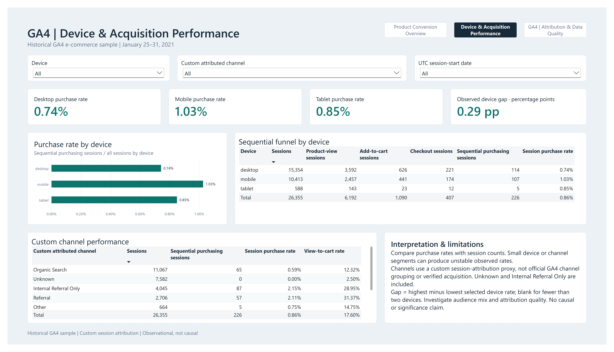
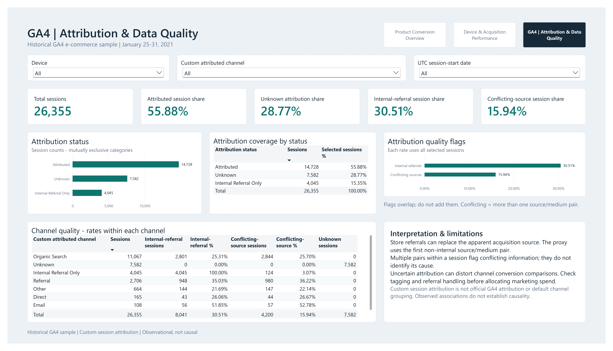

# Olist Analytics Engineering Platform

## Overview

An end-to-end analytics engineering and advanced data analytics portfolio built around Olist e-commerce data. Python ingestion and BigQuery feed tested dbt facts, dimensions and reporting marts; local Airflow orchestration supports business intelligence and validated Gemini-generated insights. The project extends into customer cohorts and repeat purchasing, synthetic experimentation, a separate GA4 product-analytics pipeline, and revenue forecasting research.

**Project status: October 12, 2026.** This is a locally validated portfolio project, not a production deployment. Forecasting remains **in progress**.

| Capability | Implemented evidence |
| --- | --- |
| Business intelligence | Seven-page Power BI report combining Olist reporting/customer analytics with clearly labeled synthetic A/B results |
| Customer analytics | Monthly cohorts, periodic retention, complete-follow-up three-month return and purchase-behaviour segments |
| GA4 product analytics | Four US-region dbt models; 67 warehouse tests passed; 26,355 reconstructed sessions |
| Revenue forecasting — in progress | Validated 86-week EU mart, five forecasting methods, rolling backtests, error/ACF diagnostics and historical interval experiments |
| AI insights | Gemini commentary grounded in warehouse KPIs, structured validation, numeric checks and synchronized reports |

A standalone [synthetic checkout A/B test case study](experimentation/CASE_STUDY.md)
demonstrates sample-size planning, statistical inference, sample ratio mismatch,
Monte Carlo power and false positives, and hypothetical business-impact and
guardrail evaluation. It is separate from the Olist/FX warehouse pipelines and
contains no real-company experiment or production deployment. See the
[experimentation module](experimentation/README.md) for reproducible commands.

A separate [GA4 Product Analytics & Conversion Funnel feature](analytics/models/ga4/README.md)
reconstructs sessions, investigates attribution quality, and measures sequential
conversion in the historical public GA4 sample. It uses BigQuery US under
`ga4_dev`, while Olist remains in EU under the default `dev` target. The GA4
documentation includes verified results, limitations, and read-only analysis.

## Contents

- [Business questions](#business-questions)
- [Architecture](#architecture)
- [Data sources](#data-sources)
- [Tech stack](#tech-stack)
- [Data flow](#data-flow)
- [dbt model architecture](#dbt-model-architecture)
- [Key metrics and modeling decisions](#key-metrics-and-modeling-decisions)
- [Power BI dashboard](#power-bi-dashboard)
- [Customer analytics](#customer-analytics)
- [A/B testing and experimentation](#ab-testing-and-experimentation)
- [GA4 product analytics](#ga4-product-analytics)
- [GA4 Power BI dashboard](#ga4-product-analytics--power-bi-dashboard)
- [Revenue forecasting — in progress](#revenue-forecasting--in-progress)
- [AI-generated monthly insights](#ai-generated-monthly-insights)
- [Airflow orchestration](#airflow-orchestration)
- [Docker usage](#docker-usage)
- [Testing and CI](#testing-and-ci)
- [How to run locally](#how-to-run-locally)
- [Verified results](#verified-results)
- [Known limitations](#known-limitations)
- [Future improvements](#future-improvements)
- [Repository structure](#repository-structure)

## Business questions

- How do order volume, delivered revenue, and average order value change by purchase month?
- Which customers place repeat orders, and what is their recorded spend?
- How long do deliveries take relative to estimated dates?
- How do payments reconcile with merchandise and freight totals?
- Which products and sellers contribute to individual orders?
- How do repeat purchases and monthly retention differ across acquisition cohorts?
- Where do observed GA4 sessions stop progressing through the purchase funnel, and how reliable are their attribution labels?
- Which weekly revenue forecasting methods hold up across historical evaluation windows and a flagged dataset boundary?
- How should a synthetic conversion experiment be interpreted alongside allocation quality, unmeasured guardrails and hypothetical economics?

## Architecture


The infographic highlights the analytics trust problem and the workflow: Olist ingestion into BigQuery, dbt staging/intermediate/mart layers, Airflow orchestration, Power BI reporting, and validated Gemini-generated insights, alongside separate FX ingestion.

The approved image represents the core platform workflow. Customer analytics extends the Olist marts; experimentation and forecasting are separate Python modules. GA4 has its own dbt branch and US-region target rather than a cross-region join with Olist.

Olist and FX are separate pipelines. FX rates are not used in Olist revenue calculations. Airflow sequences their execution; this does not imply a data dependency between FX and the Olist models.

## Data sources

- **Olist Brazilian e-commerce CSVs:** customers, orders, order items, payments, reviews, products, sellers, geolocation, and category translations. Place the original files in `data/raw/olist/`; expected filenames are defined in `ingestion/olist/load_olist_bigquery.py`. Data files are not committed. dbt currently uses customers, orders, order items, payments, products, and sellers.
- **Frankfurter REST API:** latest or historical exchange rates. Dated raw JSON files are saved under `data/raw/fx/`; warehouse rows include source and ingestion timestamps.
- **Public GA4 sample:** `bigquery-public-data.ga4_obfuscated_sample_ecommerce`, restricted to January 25–31, 2021. Historical obfuscated events are separate from the Olist source data.
- **Synthetic checkout experiment:** reproducibly generated user outcomes, with hypothetical financial assumptions. These are educational experiment results, not observed Olist transactions or a deployed product test.

## Tech stack

| Technology | Role |
| --- | --- |
| Python 3.11, Requests, BigQuery client | Ingestion, validation, warehouse loading |
| BigQuery SQL | Analytical storage and transformations |
| dbt Core, dbt-bigquery, Jinja | Dependencies, materializations, macros, data tests |
| Power BI Desktop, PBIP/PBIR | Stakeholder-facing dashboard using the BigQuery/dbt analytical layer |
| Gemini / Google GenAI | Structured business commentary from trusted KPIs |
| Pydantic | Structured AI response validation |
| pytest | Ingestion, KPI retrieval, AI validation, and Airflow integration tests |
| Apache Airflow | External/local orchestration |
| Docker Compose | Local Python/dbt runtime |
| GitHub Actions | pytest and dbt parse on pushes and pull requests |
| Statsmodels, SciPy, NumPy | Experiment planning/inference, simulations, statistical forecasting candidates and time-series diagnostics |
| Matplotlib | Reproducible experiment summaries, forecast comparisons and diagnostic charts |

## Data flow

1. The Olist loader applies explicit schemas and replaces nine raw tables using `WRITE_TRUNCATE`.
2. Staging exposes source fields and standardizes selected names. Intermediate models enrich records and aggregate payments and items to order grain.
3. dbt marts calculate trusted business metrics and provide facts, dimensions, customer metrics, and monthly reporting datasets.
4. After dbt validation, Python fetches monthly reporting KPIs from BigQuery. Gemini generates narrative only; Pydantic checks the response structure and deterministic Python validation rejects unsupported numerical claims, including unsupported derived numbers. Validated JSON and Markdown reports are saved.
5. Separately, Power BI imports Olist reporting and customer-cohort/repeat-behaviour marts. Disconnected synthetic A/B CSV fixtures support two additional experiment pages without mixing their results into Olist KPIs.
6. Independently, the FX runner validates API responses, saves raw JSON, and appends normalized currency rows. A date-level existence check skips previously loaded dates.
7. GA4 events are staged, reconstructed into sessions, assigned a custom attribution proxy, and aggregated into a sequential session funnel under the US `ga4_dev` target.
8. The EU weekly revenue mart supplies a read-only Python forecasting workflow. Saved snapshots support reproducible offline backtesting and uncertainty experiments.

## dbt model architecture

| Target / layer | Models | Materialization |
| --- | ---: | --- |
| Olist `dev` — staging | 6 | Views |
| Olist `dev` — intermediate | 6 | Views |
| Olist `dev` — normal marts/reporting | 11 | Tables |
| Olist `dev` — incremental demonstration | 1 | Incremental |
| GA4 `ga4_dev` — staging / intermediate / mart | 1 / 2 / 1 | Views / views / table |

The default **`dev` target enables 24 Olist models in BigQuery EU**, including the weekly forecasting input mart. **`ga4_dev` enables four GA4 models in BigQuery US**. Each target disables the other model family. Current manifests define **156 Olist data tests** and **67 GA4 data tests**; definitions and passing warehouse results are distinguished below.

`fct_orders_incremental` remains a demonstration; it and its four tests are excluded from normal orchestration and non-incremental validation. `ref()`/`source()` dependencies describe lineage, while schema and singular tests cover keys, relationships, calendar coverage and reconciliation. See [Olist model documentation](analytics/README.md) for model grains, [GA4 documentation](analytics/models/ga4/README.md) for its separate lineage, and the [weekly mart schema](analytics/models/marts/weekly_revenue_forecasting.yml) for forecasting input definitions. Some older Olist documentation retains the original 19-model inventory.

## Key metrics and modeling decisions

- **Order grain:** payments and items are aggregated separately before joining orders, avoiding multiplication of payment totals across item rows.
- **Customer identity:** `customer_id` identifies an order-associated record; `customer_unique_id` groups repeat purchases. The customer dimension selects the latest order's attributes.
- **Monthly attribution:** KPIs are grouped by purchase month. Delivered metrics describe orders purchased in that month whose current status is delivered, not orders delivered during that calendar month.
- **Revenue and spend:** delivered revenue sums qualifying payments. Customer spend and average order value include all order statuses. Missing payments may remain null. These are payment-based measures, not profit.
- **Delivery:** facts calculate elapsed delivery days and delay relative to the estimated date.
- **Growth:** safe division and consecutive-month checks avoid misleading comparisons across gaps or zero denominators.
- **Reporting window:** January 2017 through August 2018 is chosen for stable reporting coverage. A broader monthly mart is also available.

## Power BI dashboard

The seven-page report is stored as a Power BI Project (PBIP/PBIR) under [dashboard/](dashboard/), with [Data Analytics.pbip](dashboard/Data%20Analytics.pbip) as its entry point. It connects in Import mode to Olist reporting facts, dimensions and customer marts. The two A/B pages use disconnected synthetic fixtures; their experimental outcomes and hypothetical economics are not real Olist business results.

### Dashboard preview


The report contains seven pages with consistent navigation:

- **Executive Overview:** delivered revenue, orders, customers, average order value, repeat customers, and monthly trends.
- **Delivery Performance:** delivery times, late-delivery rates, delay days, delivery status, and state comparisons.
- **Geography Performance:** state-level revenue, orders, customers, average order value, and delivery performance.
- **Product & Seller Performance:** merchandise value, items, products, sellers, and category/seller-state analysis.
- **Customer Retention & Cohorts:** cohort matrix, weighted periodic retention, cumulative three-month return and customer purchase-behaviour segments.
- **A/B Results:** synthetic control/treatment conversion, effect size, confidence interval and statistical inference.
- **A/B Quality & Decision:** allocation quality, hypothetical contribution/cost scenarios, guardrail availability and a conditional decision.

[View the original four-page Power BI dashboard PDF](docs/powerbi/olist-analytics-dashboard.pdf). The screenshots above and this PDF cover the original four pages; saved screenshots for pages 5–7 are not currently included. See the [customer page notes](docs/powerbi/customer-purchase-behaviour.md) and [seven-page A/B layout](docs/powerbi/ab-testing-seven-pages.md) for the added report definitions and validation scope. Static PBIR/TMDL checks do not establish every Desktop interaction or cached result.

## Customer analytics

`int_customer_cohorts` assigns each stable customer to the first observed delivered-purchase month. `int_customer_monthly_activity` records delivered activity; `customer_cohort_retention` builds a complete observable monthly grid with a fixed original cohort size. Future follow-up is absent rather than converted to zero. The reporting cutoff defaults to August 31, 2018.

`customer_repeat_behavior` distinguishes repeat purchasing within the acquisition month from later-month returns. Its cumulative M1–M3 return metric uses only customers with complete three-month follow-up; it is not periodic M3 retention or a sum of monthly rates. Segments are Single-purchase, Same-month repeat only, and Cross-month repeat.

Documented reconciliation references for January 2017–May 2018 cohorts contain **75,123 customers**: **72,527 single-purchase**, **984 same-month repeat only**, and **1,612 cross-month repeat**. **790 / 75,123 = 1.052%** returned during M1–M3. These historical observations show that one observed delivered purchase dominates this cohort window; they do not establish subscription churn, lifetime loyalty or the causes of low repeat purchasing.

See the [mart definitions and reconciliation references](analytics/models/marts/customer_repeat_behavior.yml), [retention page notes](docs/powerbi/customer-retention-page.md), and [purchase-behaviour documentation](docs/powerbi/customer-purchase-behaviour.md). Offline reference calculations and Desktop/DAX verification are documented separately.

## A/B testing and experimentation

The [synthetic checkout case study](experimentation/CASE_STUDY.md) covers prespecified two-sided hypotheses, sample-size/MDE/power planning, two-proportion statistical tests, Newcombe/Wilson confidence intervals, sample ratio mismatch detection, and Monte Carlo power/false-positive simulations. Guardrail tooling and hypothetical contribution, implementation-cost and break-even analysis connect statistical results to a conditional business decision.

The reproducible seed-42 experiment uses **4,433 users per arm** and observes **1.7144 percentage points** of uplift. The case study does not recommend a full rollout: assumed economics and unmeasured payment/refund/latency guardrails remain important. Synthetic statistical evidence is not evidence from a real deployed experiment. Read the [module guide](experimentation/README.md) and [rendered experiment executive summary](docs/images/checkout-ab-test-executive-summary.png) for methods, assumptions and reproduction commands.

## GA4 product analytics

The separate US-region `ga4_dev` pipeline stages nested event parameters without multiplying raw rows, reconstructs sessions using `(user_pseudo_id, ga_session_id)`, and preserves every observed session in its funnel mart. **67 GA4 dbt tests passed against BigQuery**, covering event/session fields, composite grain, complete coverage, attribution consistency and ordered funnel progression.

For January 25–31, 2021, verified counts are **273,507 events**, **21,596 pseudonymous users**, and **26,355 sessions**. Sequential `view_item → add_to_cart → begin_checkout → purchase` counts are **6,192 → 1,090 → 407 → 226**. Stage flags require preceding stages in timestamp order; independent event-presence flags do not. Equal timestamps may qualify together, and product-level continuity is not enforced.

Device and custom-channel conversion analysis uses all sessions in each segment as its denominator. First-user acquisition source/medium remain available in staging and are kept separate from event/session attribution. The earliest complete non-internal event source/medium pair supplies a **custom attribution proxy, not Google's official GA4 session attribution**. Both merchandise-store domain self-referrals are investigated explicitly: **8,041 sessions** contain internal referrals, **4,045** are internal-only, and **4,200** contain conflicting pairs. These flags overlap; they do not prove a tracking cause.

See the [GA4 feature documentation](analytics/models/ga4/README.md) and [read-only funnel analysis](analytics/analyses/ga4/session_funnel_analysis.sql). GA4 is a separate historical obfuscated sample, not Olist web activity. Its standalone Power BI dashboard is documented below.

## GA4 Product Analytics — Power BI Dashboard

A separate three-page Power BI dashboard turns the **January 25-31, 2021** seven-day historical, obfuscated GA4 e-commerce sample into a view of conversion, device performance, and attribution quality. It covers **26,355 sessions** and **21,596 pseudonymous users**; these are historical observations, not current store performance.

The sequential funnel contains **6,192 product-view sessions**, **1,090 add-to-cart sessions**, **407 checkout sessions**, and **226 purchasing sessions**, giving a **0.86% sequential session purchase rate** across all sessions.

### Product Conversion Overview

Shows where sessions stop progressing from product discovery to purchase, with daily session trends and stage conversion/drop-off rates to guide further investigation.


### Device & Acquisition Performance

Compares device and custom-channel conversion alongside session volumes. Device, channel, and UTC session-start date slicers support exploration; observed differences are not causal findings or randomized A/B test results.



### Attribution & Data Quality

Shows attribution coverage and measurement-quality indicators before channel comparisons inform marketing decisions. **55.88%** of sessions are attributed and **28.77%** have unknown attribution. **30.51%** contain internal referrals and **15.94%** contain conflicting source/medium pairs; these two flags overlap and must not be added.



Acquisition attribution uses a **custom session-level proxy**, not official GA4 attribution or GA4 default channel grouping. The dashboard is separate from the seven-page Olist report and contains no simulated experiments.

[Full three-page dashboard PDF](docs/powerbi/GA4%20Product%20Analytics.pdf) | [Editable Power BI project](dashboard/ga4/GA4%20Product%20Analytics.pbip) | [Dashboard setup and metric guide](dashboard/ga4/README.md) | [GA4 dbt documentation](analytics/models/ga4/README.md)

## Revenue forecasting — in progress

The validated [weekly revenue mart](analytics/models/marts/weekly_revenue_forecasting.sql) supplies **86 consecutive Monday–Sunday weeks**, January 2, 2017–August 20, 2018, with **96,095 delivered orders** and **R$15,363,879.91** in payment value. Its **14 dbt tests passed**; the verified window has no missing-payment orders. Revenue remains payment-based by purchase week, without transformation rounding or silent order-level payment imputation.

The [forecasting module](forecasting/README.md) implements read-only EU extraction and offline snapshot replay, Naïve/MA4/MA8 baselines, Drift and training-only Simple Exponential Smoothing, chronological expanding-window backtests, MAE/RMSE/WAPE/signed bias, forecast-error diagnostics, and exploratory trend/ACF analysis. The original 12-week holdout remains reproducible; 52-week-warm-up experiments evaluate 34 full-series or 33 boundary-excluded targets.

Naïve is the provisional preferred MAE/WAPE baseline: on the full rolling sample its MAE is **R$34,070.94** and WAPE **13.72%**. MA8 has lower full-sample RMSE. SES narrowly wins boundary-excluded MAE by **R$16.27/week (0.053%)**, with worse RMSE; no candidate demonstrates a robust universal improvement. Raw-order investigation confirmed the late-August decline exists upstream of dbt, but its cause and source-end completeness remain unresolved.

A [historical empirical prediction-interval experiment](forecasting/prediction_intervals.py) and its automated tests are implemented. Intervals use only previously observed Naïve errors, with 20 additional calibration origins. Full-series observed coverage is **78.57% / 85.71%** for nominal **80% / 90%** intervals over 14 usable weeks. This is exploratory uncertainty analysis and illustrative business planning, not validated future forecasts or guaranteed coverage.

Forecasting remains in progress: only 86 historical observations are available, fewer than two annual cycles; overlapping origins are not independent experiments; current delivered status may leak as-of information. Generated CSVs, PNGs and reports remain ignored under `forecasting/outputs/`. Reproduce them from the module guide rather than relying on GitHub links to local generated files. Operational forecasting, annual seasonality and production deployment are not claimed.

## AI-generated monthly insights

The workflow reads BigQuery/dbt monthly reporting KPIs from `monthly_revenue_reporting`. Python retrieves and formats the trusted metrics; Gemini produces structured stakeholder commentary without calculating new metrics.

From the repository root, generate the latest available reporting month or request a specific month:

```bash
python -m ai.generate_insights
python -m ai.generate_insights --month YYYY-MM
```

Pydantic enforces the response contract. A deterministic numeric validator rejects unsupported numbers, including fabricated or unsupported derived values, and retries generation once when numeric validation fails. The same validated response and KPI payload produce synchronized JSON and Markdown reports in `ai/outputs/`; generated files are excluded from version control.

The design principle is: **Warehouse / Python = facts and calculations; Gemini = narrative; Python validation = grounding gate.** Live execution requires BigQuery authentication, Google GenAI and Pydantic dependencies, and `GEMINI_API_KEY` in the environment.

## Airflow orchestration

The DAG is included at `orchestration/airflow/dags/fx_pipeline.py`. Airflow runs externally/locally, for example in WSL; it is not containerized in this repository.

The daily 07:00 schedule follows Airflow's configured timezone. Tasks retry twice with a one-minute delay and execute `run_fx_ingestion` -> `run_dbt_project` -> `test_dbt_project` -> `generate_ai_insights`. FX ingestion uses the logical date; the AI task runs after successful dbt tests and automatically selects the latest available reporting month. Both dbt commands exclude `fct_orders_incremental`. Olist raw tables must already exist; the DAG does not load the Olist CSVs.

Paths are configurable. See [Airflow setup](orchestration/airflow/README.md). DagBag/import validation passed, and a real full four-task DAG run completed successfully locally. The AI task automatically resolved the reporting month, generated validated insights, and saved JSON and Markdown outputs. This is local validation evidence, not a production deployment.

## Docker usage

From the repository root:

```bash
docker compose build
docker compose run --rm analytics
docker compose run --rm analytics dbt parse
docker compose run --rm analytics dbt debug
docker compose run --rm analytics dbt run --exclude fct_orders_incremental
docker compose run --rm analytics dbt test --select fct_order_items
docker compose run --rm analytics dbt test --exclude fct_orders_incremental
```

The default Compose command runs pytest from `/app`; explicit dbt commands run from `/app/analytics`. Rebuild after code or SQL edits because files are copied at image build time. **Current packaging limitation:** the Dockerfile copies the core modules and tests but does not yet copy `forecasting/`. The new forecasting tests therefore cannot be collected successfully from that image as-is; use the local Python workflow for the complete current suite until packaging is updated.

Compose mounts Windows host dbt and Google application-credential directories read-only using `USERPROFILE` and `APPDATA`. Adapt these mounts for other host operating systems. Credentials are not included in the image. Warehouse commands require external authentication and a dbt profile.

## Testing and CI

- **Python:** current collection contains 456 tests spanning ingestion, KPI/AI validation, Airflow integration, experimentation, dashboard fixture contracts, forecasting and target isolation. The latest targeted forecasting/isolation run passed 69 tests. A prior full local run reported 419 passes and one Windows CRLF-versus-LF fixture comparison failure; that was before the latest diagnostic additions, not a claim that all 456 currently pass.
- **dbt:** manifests define 156 Olist tests under `dev` and 67 GA4 tests under `ga4_dev`. The original Olist baseline's 91 non-incremental tests were historically warehouse-validated; the weekly mart's 14 tests and full GA4 suite's 67 tests have separately passed. This does not claim a fresh run of all current Olist tests.
- **GitHub Actions:** preserves pytest and placeholder-profile parsing, then runs the offline [target-isolation guard](analytics/ci/validate_ga4.py). It checks 24 Olist / 4 GA4 model isolation and 67 GA4 test definitions without production credentials or warehouse runs. Compilation can initialize authentication and is not advertised as credential-free CI validation.

Parsing checks project structure and Jinja processing, not successful SQL execution in BigQuery.

## How to run locally

Use Python 3.11 with an activated virtual environment. From the repository root:

```bash
python -m pip install -r requirements-docker.txt
python -m pytest -v
```

`requirements-docker.txt` is the shared Docker/CI dependency set. `requirements.txt` records a broader development environment; it is not required in addition for these commands. Airflow requires a separate installation.

For warehouse execution, configure Google application authentication and an `analytics` dbt profile outside the repository. Ensure the raw dataset exists and the account can load raw tables and build the target dataset. The current local BigQuery project is `mda-platform-2026`; ingestion constants, dbt sources, and Compose reference it. Another project requires aligning those settings and the external profile. A profile change alone is insufficient.

After placing the Olist CSVs in `data/raw/olist/`:

```bash
python -m ingestion.olist.load_olist_bigquery
python -m ingestion.fx_api.run_fx_pipeline --date 2025-01-15
```

The Olist command replaces raw tables. The FX command is independent and optional for Olist analytics. From `analytics/`, with the profile in dbt's default location or a directory selected by `DBT_PROFILES_DIR`:

```bash
dbt parse
dbt run --exclude fct_orders_incremental
dbt test --exclude fct_orders_incremental
```

GA4 requires its explicitly selected US target; forecasting is a separate Python workflow. See [GA4 reproduction commands](analytics/models/ga4/README.md) and [forecasting commands](forecasting/README.md) for targeted runs, offline replay and generated reports. The Airflow DAG does not execute the Python forecasting experiments or select `ga4_dev` automatically.

## Verified results

| Validation | Result |
| --- | --- |
| Python validation | 456 tests currently collected; latest targeted forecasting/isolation run: 69 passed; known earlier Windows fixture line-ending failure noted above |
| Original Olist baseline, historical warehouse validation | 18 models and 91 tests passed before customer/forecasting additions; incremental demonstration excluded |
| GA4 warehouse validation | Four US-region models, 67 tests passed; 26,355 sessions and 226 sequential purchasing sessions |
| Weekly revenue mart | 86 EU-region rows; 14 tests passed; complete weekly calendar and payment/revenue reconciliation |
| Forecasting experiments | Offline baseline/candidate comparisons, rolling backtests, trend/error diagnostics and chronological interval calibration implemented and tested; project remains in progress |
| `fct_order_items` against BigQuery | Table built successfully; approximately 112.7k rows; all 9 selected tests passed |
| dbt parse, including Compose execution | Passed |
| Airflow DAG | DagBag/import validation passed; full four-task local DAG execution completed successfully |
| AI insights | Structured response validation, numeric grounding, and retry behavior verified; a successful local run generated synchronized JSON and Markdown reports |

These are local validation results, not production deployment evidence or CI warehouse checks.

## Known limitations

- Warehouse identifiers are hardcoded; data acquisition and profile setup are manual.
- FX is separate from Olist analytics. Its duplicate-date check is not concurrency-safe and broadly catches check failures.
- The incremental demonstration does not reliably handle updates to older orders or late-arriving records.
- Reviews, geolocation, and category translations are loaded but not modeled downstream.
- Python tests do not provide end-to-end API/warehouse coverage; CI does not validate SQL execution against BigQuery.
- Power BI Service deployment and scheduled Power BI refresh are not configured in this repository.
- Production deployment is not implemented.
- Live AI generation requires Gemini API availability and credentials; narrative quality depends on the configured model/API. Numeric grounding validation does not prove full semantic correctness.
- New Power BI pages have documented static validation and reference checks; pages 5–7 do not yet have committed screenshot assets. The existing PDF remains a four-page snapshot.
- Docker packaging currently omits `forecasting/`; older Olist documentation still contains baseline inventory counts. Those files are unchanged by this README update.
- Forecasting uses a short retrospective series with an unresolved boundary observation and possible as-of status leakage. Historical interval coverage is not a future guarantee; annual seasonality is not established.

## Future improvements

- Parameterize warehouse configuration and improve setup portability.
- Add ingestion failure-path tests and stronger load reconciliation.
- Extend incremental processing for updates and late arrivals.
- Document stakeholder usage and report maintenance.
- Schedule delivery of generated reports, such as Slack/email delivery.
- Strengthen semantic validation and AI evaluation.
- Define production deployment, monitoring, observability, and refresh operations.
- Extend model and test coverage for additional source tables.

These are proposed improvements, not current capabilities.

## Repository structure

```text
ingestion/                  Python Olist and FX ingestion
analytics/
  models/staging/olist/      Source-facing models
  models/intermediate/      Enrichment and aggregation
  models/marts/             Facts, dimensions, metrics, reporting
  models/ga4/               Separate US staging, sessions, attribution and funnel
  analyses/ga4/             Read-only funnel and segmentation analysis
  ci/                       Offline target-isolation checks
  macros/                   Growth and cohort-cutoff helpers
ai/                        Validated AI insight generation and grounding logic
experimentation/             Standalone synthetic A/B testing case study and tools
forecasting/                Weekly baselines, candidates, backtests and diagnostics
orchestration/airflow/       Portable DAG and external setup notes
dashboard/                  Power BI PBIP/PBIR report project
docs/                       Architecture, screenshots, PDF and report-page notes
tests/                      Python tests
.github/workflows/ci.yml     Credential-free CI
Dockerfile                  Python/dbt image
compose.yaml                Local analytics service
requirements-docker.txt     Docker/CI dependencies
requirements.txt            Broader development dependency snapshot
```
