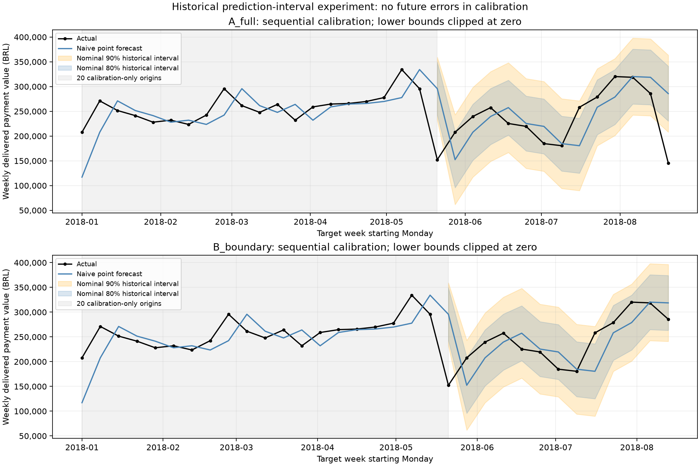

# Olist weekly revenue forecasting: a retrospective case study

## Business question and conclusion

Can simple weekly forecasts provide a useful planning baseline, and how much confidence should a business place in them? Five models were compared on the same historical targets, followed by endpoint sensitivity and an empirical uncertainty experiment.

**Naive is the provisional MAE/WAPE baseline, not a universally superior model.** Forecast uncertainty is wide, and the final-snapshot target was not fully observable at historical forecast origins. These results demonstrate analytical discipline and reproducibility, not operational forecast validation.

## Data and historical validity

The dataset contains **86 consecutive Monday-Sunday purchase weeks**, January 2, 2017 through August 20, 2018 (final Sunday August 26). Revenue is payment value for orders ultimately recorded as delivered: **R$15,363,879.91** in total. It is not profit or cash receipts.

A read-only local audit aggregated the original Olist orders and payments CSVs and matched all 86 snapshot revenues within R$0.000001. No BigQuery query was needed for this reconciliation.

| Purchase week starting | Recorded orders | Eventually delivered | Payment value (BRL) |
| --- | ---: | ---: | ---: |
| August 13, 2018 | 1,875 | 1,839 | 285,766.68 |
| August 20, 2018 | 1,071 | 1,054 | 145,680.87 |

The final week has a **49.02% revenue decline**, with orders recorded on all seven days of August 20-26 and delivered purchases continuing through August 29. Classify it as a **suspicious boundary observation, completeness unconfirmed**. Neither the decline nor valid calendar coverage proves an incomplete or complete population. Retain it in primary results and show exclusion as sensitivity, not data correction.

## Evaluation and model comparison

Naive, four/eight-week moving averages, Drift and simple exponential smoothing use preceding observations only. History expands after each target; SES fits its smoothing parameter within each training history. Scores are retrospective one-week-ahead MAE, RMSE, WAPE and signed bias.

- **A_full:** 52 training weeks, 34 targets from January 1-August 20, 2018.
- **B_boundary:** same warm-up, 33 targets through August 13; removes only the flagged endpoint.
- **C_original:** 74 training weeks, the original 12 targets from June 4-August 20.

### Full rolling sample: 34 targets

| Model | MAE (BRL) | RMSE (BRL) | WAPE |
| --- | ---: | ---: | ---: |
| NAIVE | 34,070.94 | 48,653.16 | 13.72% |
| MA4 | 39,167.37 | 54,475.96 | 15.78% |
| MA8 | 35,221.09 | 46,454.66 | 14.19% |
| DRIFT | 34,245.81 | 49,005.50 | 13.79% |
| SES | 34,281.65 | 49,798.26 | 13.81% |

Naive leads MAE/WAPE; MA8 leads RMSE. The original 12-target holdout also favors Naive, with MAE R$36,743.37 and WAPE 15.13%.

### Excluding the final observation: 33 targets

| Model | MAE (BRL) | RMSE (BRL) | WAPE |
| --- | ---: | ---: | ---: |
| NAIVE | 30,858.37 | 42,944.07 | 12.28% |
| MA4 | 35,650.67 | 48,243.88 | 14.18% |
| MA8 | 32,950.26 | 43,077.92 | 13.11% |
| DRIFT | 30,936.76 | 43,020.80 | 12.31% |
| SES | 30,842.09 | 43,510.52 | 12.27% |

SES's MAE advantage over Naive is only **R$16.27 per week (0.053%)**, with worse RMSE. Naive MAE improves by R$3,212.57 after removing the endpoint. Shared predictions are unchanged; overlapping samples are not independent experiments, and exclusion does not prove corruption or a causal explanation. No model is established as universally superior.

## Historical prediction intervals

The Naive experiment calibrates nominal 80%/90% intervals using an expanding history of previously observed absolute errors. The first 20 rolling forecast origins are calibration-only. Radius is the `ceil((n+1) * nominal coverage)`-th smallest prior error, without interpolation; the current error enters history afterward. Lower bounds are clipped at zero. No saved evaluated lower bound needed clipping.

| Sample | Nominal | Evaluated | Observed coverage | Mean width (BRL) |
| --- | ---: | ---: | ---: | ---: |
| Full | 80% | 14 | 78.57% | 111,006.03 |
| Full | 90% | 14 | 85.71% | 168,156.26 |
| Endpoint excluded | 80% | 13 | 84.62% | 111,022.60 |
| Endpoint excluded | 90% | 13 | 92.31% | 169,136.55 |

Usable targets begin May 21, 2018. All shared intervals are identical; the August 20 actual misses both levels, so its exclusion changes the coverage denominator and removes a miss. It does not improve calibration. Nominal coverage is the chosen calibration level; observed coverage is the fraction covered in this small historical evaluation.

Mean full-sample widths are approximately **45.38% / 68.74% of the mean point forecast**. The ranges can illustrate downside/upside scenarios, but are not guaranteed revenue floors, spending authority or staffing plans. Margins, cash timing, orders and capacity need separate assumptions. With only 14/13 targets, temporal dependence and unverified stationarity/information availability, future coverage is not guaranteed.

## Information availability and limits

The target uses finalized delivered statuses and payment totals assigned back to purchase weeks. **1,595 of the preceding week's 1,839 eventually delivered orders were delivered on or after August 20**. At a Monday-start origin their eventual delivered status was not yet observable. Payment rows have no availability timestamps for reconstructing what was known then.

Chronological row ordering prevents direct use of later target rows, but cannot remove retrospective outcome information inside earlier rows. This affects both model training and when historical calibration errors become available. These are **retrospective forecasting experiments, not operationally valid historical forecasts**.

Only 86 weeks are available, fewer than two annual cycles. The business cause of the final decline and exhaustive source capture are unresolved. Source/provenance evidence or point-in-time histories would be needed for stronger claims; querying the same final extract alone cannot supply them.

## Evidence and reproduction

The files below are byte-preserving copies of selected existing artifacts, not newly manipulated predictions:

| Evidence | Scope |
| --- | --- |
| [Five-model comparison](model-comparison.csv) | All five models across A/B/C, including scores and evaluation sizes |
| [Endpoint sensitivity](endpoint-sensitivity.csv) | B-minus-A deltas and ranks for the original three baselines only |
| [Interval metrics](prediction-interval-metrics.csv) | Coverage, widths, calibration skips and missed weeks |
| [Uncertainty visual](prediction-intervals.png) | Existing historical 80%/90% chart |
| [Source snapshot](source-snapshot.csv) | 86 aggregate input weeks for credential-free replay |
| [Original predictions](original-predictions.csv) | 12-target reference for unchanged-baseline checks |

Full-precision CSVs are authoritative; tables round for readability. Original raw CSVs and the other generated outputs remain ignored. The selected inputs contain weekly aggregates, not customer/order identifiers or credentials. Endpoint-sensitivity CSV ranks are within the three-baseline comparison, while the five-model CSV includes Drift and SES.

See [methods and offline commands](../../forecasting/README.md), the [dbt mart](../../analytics/models/marts/weekly_revenue_forecasting.sql), and its [tests/definitions](../../analytics/models/marts/weekly_revenue_forecasting.yml). Reproduction needs no warehouse connection; no live operational forecast or guaranteed coverage is claimed.

## Validation status

On October 13, 2026, 70 targeted forecasting/isolation tests passed locally and in Docker. All six offline CLIs ran from the copied inputs and reproduced the selected numerical results. Docker build, placeholder-profile dbt parse and the offline isolation guard passed; no warehouse queries ran.

After correcting the A/B fixture test to compare exact parsed CSV rows across platforms, the full local and container suites each passed all 457 tests. The earlier line-ending failure and its resolution are documented in the [validation record](../../forecasting/README.md#finalization-validation---october-13-2026). No remote CI run is claimed. Model formulas, original outputs, fixture values, dbt models and Power BI definitions were preserved.
